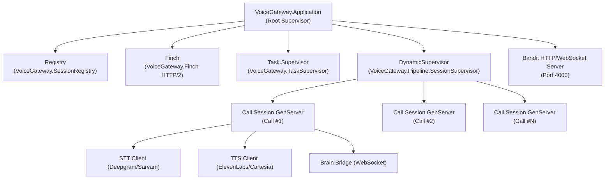

# VoiceGateway Architecture

VoiceGateway is designed around the actor model and OTP supervision trees. Every live phone call is an independent, isolated process.

---

## Supervision Tree Hierarchy

---

## Core Components

### 1. `VoiceGateway.Pipeline.Session`
The central state machine managing an active call:
* Tracks states: `:listening`, `:thinking`, `:speaking`, `:ended`.
* Owns the incoming telephony transport process and coordinates STT, TTS, and Brain clients.
* Traps exits and monitors `transport_pid` for immediate, clean resource deallocation.

### 2. `VoiceGateway.Codec.G711`
A compile-time optimized ITU-T G.711 codec:
* `decode_mulaw/1`: Translates 8kHz μ-law (PCMU) into 16-bit linear PCM.
* `encode_mulaw/1`: Translates 16-bit linear PCM into 8kHz μ-law.
* `decode_alaw/1` & `encode_alaw/1`: European A-law (PCMA) transcoding.
* Incorporates trailing half-sample discard clauses to guard against split network packets.

### 3. `VoiceGateway.Pipeline.Buffer`
Audio frame packetizer:
* Collects variable-sized audio chunks from WebSocket ingress.
* Slices chunks into exact 20ms (160-byte) telephony packets.
* Supports instantaneous queue flushing on caller barge-in.
